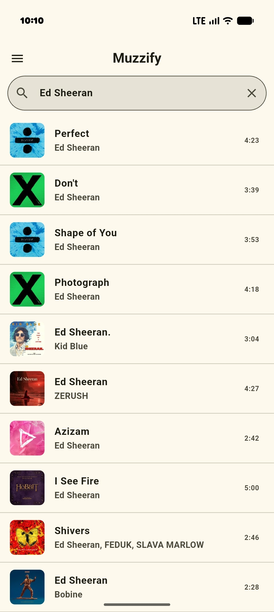
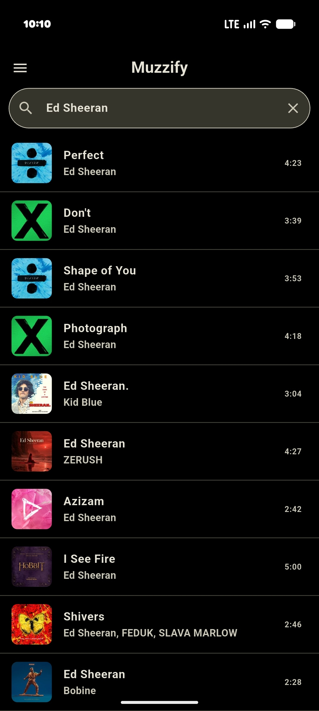

# 🎵 Muzzify

A Flutter app for searching tracks in Yandex Music.

🔗 [Читать на русском / Read in Russian](README_RU.md)

## ✨ About

Muzzify is a Flutter application that lets you search for tracks in Yandex Music. It uses OAuth 2.0 for authentication, supports real-time search with pagination, and is built with a clean, layered architecture.

The project is a portfolio piece demonstrating:

- 🧩 Clean Architecture (domain / data / presentation layers)
- 🧠 BLoC for state management
- 🧭 go_router for navigation
- 💉 get_it for dependency injection
- 🔐 OAuth 2.0 via webview_flutter
- 🌐 Localization (English / Russian)

## 🚀 Features

- 🔍 Track search — search Yandex Music's catalog with paginated results
- 🔐 OAuth 2.0 authentication — secure login via WebView
- 🛡️ Secure token storage — tokens are stored in flutter_secure_storage
- 🧠 State management — BLoC (Cubit) for predictable UI states
- 🧭 Declarative routing — go_router with auth-based redirects
- 🎨 Material 3 — modern UI with light/dark theme support
- 🌐 Localization — English and Russian

## 🛠 Tech Stack

| Category | Technology |
|---|---|
| State management | flutter_bloc (Cubit) |
| Navigation | go_router |
| Dependency injection | get_it |
| HTTP client | dio |
| Secure storage | flutter_secure_storage |
| WebView | webview_flutter |
| XML parsing | xml |
| URL handling | url_launcher |
| Localization | flutter_localizations + intl |

## 📸 Screenshots

 

## 📄 License

This project is licensed under the MIT License — see the LICENSE file for details.

## 🙏 Acknowledgments

- Yandex Music API for the data
- Flutter and the Dart team
- The open-source packages that made this project possible
