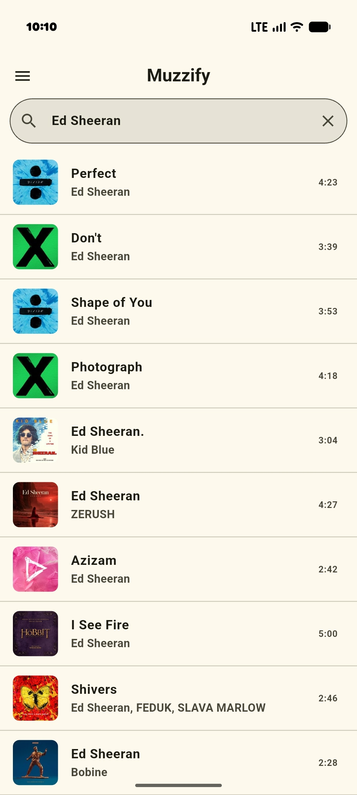
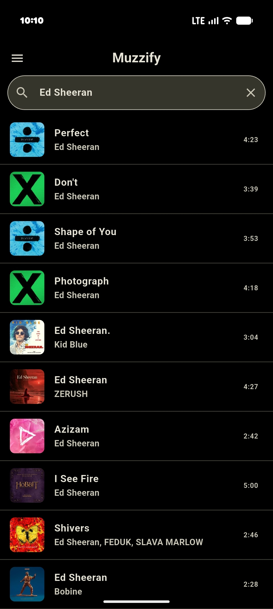

# 🎵 Muzzify

Приложение на Flutter для поиска треков в Яндекс Музыке.

🔗 [Read in English / Читать на английском](README.md)

## ✨ О проекте

Muzzify — это Flutter-приложение, которое позволяет искать треки в каталоге Яндекс Музыки. В нём реализована аутентификация по OAuth 2.0, поддержка поиска в реальном времени с пагинацией и чистая многоуровневая архитектура.

Проект — портфолио, демонстрирующее работу со следующими подходами и технологиями:

- 🧩 Чистая архитектура (слои domain / data / presentation)
- 🧠 BLoC для управления состоянием
- 🧭 go_router для навигации
- 💉 get_it для внедрения зависимостей
- 🔐 OAuth 2.0 через webview_flutter
- 🌐 Локализация (английский и русский языки)

## 🚀 Возможности

- 🔍 Поиск треков — поиск по каталогу Яндекс Музыки с пагинацией результатов
- 🔐 Аутентификация по OAuth 2.0 — безопасный вход через WebView
- 🛡️ Защищённое хранение токенов — токены сохраняются в flutter_secure_storage
- 🧠 Управление состоянием — BLoC (Cubit) для предсказуемых состояний UI
- 🧭 Декларативная маршрутизация — go_router с редиректами на основе авторизации
- 🎨 Material 3 — современный интерфейс со светлой и тёмной темами
- 🌐 Локализация — английский и русский языки

## 🛠 Стек технологий

| Категория | Технология |
|---|---|
| Управление состоянием | flutter_bloc (Cubit) |
| Навигация | go_router |
| Внедрение зависимостей | get_it |
| HTTP-клиент | dio |
| Защищённое хранилище | flutter_secure_storage |
| WebView | webview_flutter |
| Парсинг XML | xml |
| Работа с URL | url_launcher |
| Локализация | flutter_localizations + intl |

## 📸 Скриншоты

 

## 📄 Лицензия

Проект распространяется по лицензии MIT — подробности в файле LICENSE.

## 🙏 Благодарности

- Яндекс Музыка API за предоставленные данные
- Команда Flutter и Dart
- Open-source пакеты, которые сделали этот проект возможным
